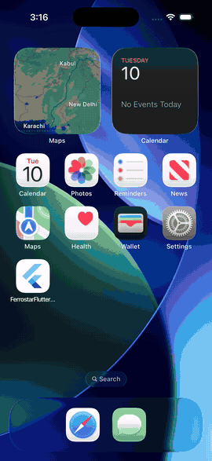
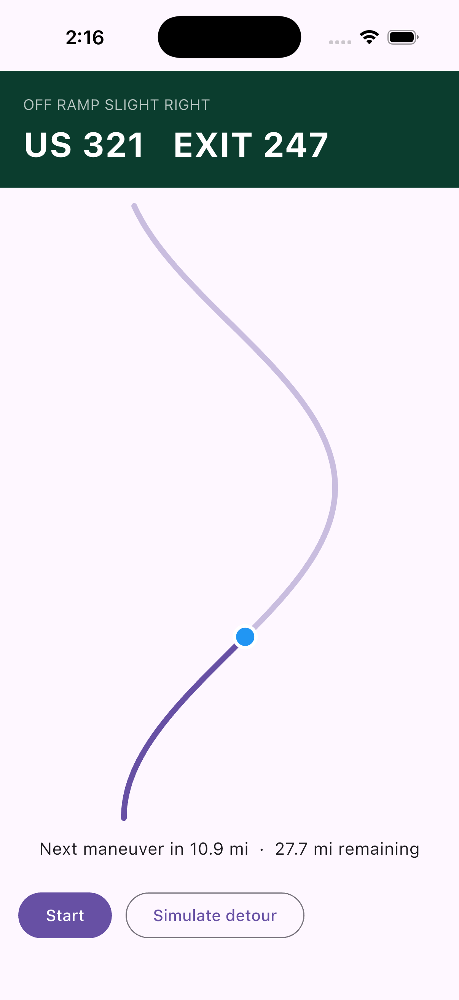
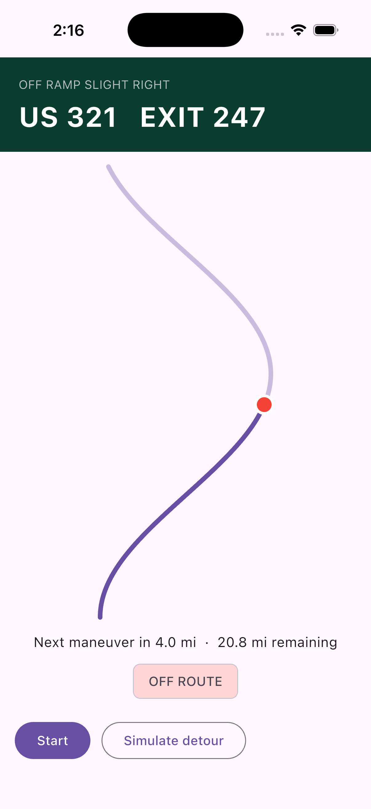
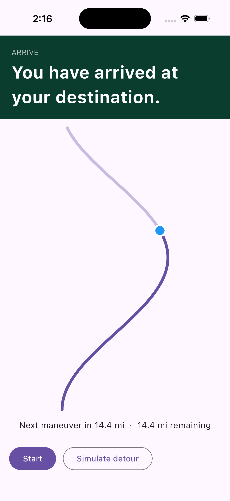

# ferrostar_flutter

[](https://pub.dev/packages/ferrostar_flutter)
[](LICENSE)

**Turn-by-turn navigation for Flutter, with no Mapbox or Google account.**

Give it a route and your GPS fixes. It tells you what to show and say:
*"In 2 miles, take exit 247 on the right onto US 321"*, how far you have left,
and when the driver has left the route. You keep your own map, your own UI and
your own voice.

<p align="center">
  
</p>

*The bundled example replaying a sample route: banner, spoken text, a detour
flagged as off route, arrival. No map and no token needed.*

## Why you might want this

* **No vendor lock-in.** No access token, no billing account. It is open source
  (BSD-3) on top of the open-source [Ferrostar](https://github.com/stadiamaps/ferrostar)
  navigation core.
* **Your UI, your map.** It draws nothing. Use `maplibre`, `flutter_map`, Google
  Maps, or a plain canvas.
* **Real instructions, not just a line.** Maneuver type and side, exit numbers,
  banner text, spoken text, distance to the next turn, time and distance left.
* **Fixed routes done properly.** It never reroutes on its own. A deviation
  raises an event and your app decides. Built for cases where the driver must
  stay on a given road (permitted oversize loads, delivery corridors, guided
  tours).
* **Fewer false alarms.** Off-route needs several trustworthy fixes in a row,
  not one GPS jump. All thresholds are configurable.
* **Easy to test.** A pure-Dart fake engine replays a route with no device.

## Install

```
flutter pub add ferrostar_flutter
```

Then a little platform setup ([details below](#platform-setup)): Android needs
core library desugaring; iOS 16+ with either Swift Package Manager or one line in
your Podfile.

## 30-second tour

```dart
final engine = PigeonFerrostarNavigationEngine();

engine.events.listen((e) {
  switch (e) {
    case FerrostarInstruction():  // banner: e.bannerPrimaryText, e.exit, e.modifier
                                  // voice:  e.spokenText (use your own TTS)
    case FerrostarProgress():     // e.distanceToNextManeuverM, e.distanceRemainingM
    case FerrostarOffRoute():     // e.isOffRoute
    case FerrostarArrived():
    case FerrostarError():
  }
});

await engine.startNavigation(routeJson);   // OSRM-style JSON (Valhalla format=osrm)

// every time your location stream gives you a fix:
await engine.updateLocation(FerrostarFix(
  lat: p.latitude, lng: p.longitude, accuracyM: p.accuracy,
  speedMps: p.speed, timestampMs: p.timestamp.millisecondsSinceEpoch,
));
```

The core never reads the device location itself: you feed it. That keeps
permissions, background location and battery policy in your hands.

<p align="center">
  
  
  
</p>

## Where does the route come from?

Anything that produces OSRM-style JSON with banner and voice instructions. With a
[Valhalla](https://github.com/valhalla/valhalla) server:

```
POST /route
{"locations":[{"lat":..,"lon":..},{"lat":..,"lon":..}],
 "costing":"truck", "format":"osrm",
 "banner_instructions":true, "voice_instructions":true,
 "directions_options":{"units":"miles"}}
```

If you already have a fixed line (a permit, a tour, a delivery corridor), convert
it to the same JSON yourself: a polyline6 geometry plus `legs[].steps[]` with a
`maneuver`, `bannerInstructions` and `voiceInstructions`.
`test/fixtures/synthetic_route_ferrostar.json` is a complete small example.

Exit numbers and ramp sides are only as good as your data: a plain centreline has
neither. If you need them, add them from OpenStreetMap (`highway=motorway_junction`
`ref`, `*_link` ways).

## What you get

| Event | When | Useful fields |
|---|---|---|
| `FerrostarInstruction` | the next maneuver, and each spoken-distance trigger | `type`, `modifier`, `exit`, `bannerPrimaryText`, `spokenText` |
| `FerrostarProgress` | every fix | distance to next maneuver, distance and time remaining, step index |
| `FerrostarOffRoute` | on state change only | `isOffRoute`, `distanceFromRouteM` |
| `FerrostarArrived` | at the destination | |
| `FerrostarError` | the route could not be used | `message` |

## Using it with a map

The engine is map-agnostic. Draw the route line and the position puck with your
map of choice and move the camera on `FerrostarProgress`. A free keyless setup is
MapLibre with a public style such as OpenFreeMap. The line is the same polyline
you passed in:

```dart
final line = decodePolyline(route['geometry'], 6);   // [[lat, lng], ...]
// draw `line`, then on each location update call engine.updateLocation(...)
```

`example/` draws the line with a plain `CustomPaint`. (A full MapLibre example is
on the roadmap; the engine does not depend on one.)

## How it compares

| | ferrostar_flutter | Vendor SDK wrappers | OSRM / Valhalla clients |
|---|---|---|---|
| Vendor token or account | none | required | none |
| Works with any map widget | yes | usually their own | n/a |
| Maneuvers, banner, spoken text | yes | yes | no |
| Off-route events | yes, configurable | yes, built in | no |
| Follows a route you supply | yes | partly | n/a |
| Reroutes on its own | no, by design | yes | n/a |
| Draws UI or plays audio | no | yes | no |

Based on public package pages as of November 2026. If you need automatic
rerouting, live traffic or a ready-made UI, a vendor SDK is the better fit; this
package is for following a route you already have.

## Off-route detection (configurable)

Ferrostar's stock detectors are single-fix checks. This package installs a
persistence rule instead, through `FerrostarEngineConfig`:

| option | default | meaning |
|---|---|---|
| `offRouteEnabled` | true | false = no deviation tracking |
| `offRouteDistanceM` | 250 | farther than this from the remaining route = "beyond" |
| `maxTrustedAccuracyM` | 100 | fixes with worse horizontal accuracy neither confirm nor clear |
| `offRouteConfirmFixes` | 3 | consecutive trusted beyond-fixes that start an off-route (1 = single-fix) |

Once off route, the first fix back within `offRouteDistanceM` clears it. The same
rule is implemented in Swift, Kotlin and Dart (`OffRouteRule`, used by the fake).

## Testing without a device

`FakeFerrostarNavigationEngine` follows a route in pure Dart and emits the same
events, so UI and BLoC tests need no device or simulator. It is a behavioural
reference, not a proof about the native core.

## Platform setup

**Android**: `minSdk 25`, and the host app must enable core library desugaring
(`isCoreLibraryDesugaringEnabled = true` plus
`coreLibraryDesugaring("com.android.tools:desugar_jdk_libs:2.1.5")`), because the
core uses `java.time`.

**iOS 16+**:
* **CocoaPods** (verified in `example/`): Ferrostar publishes no CocoaPods spec,
  so add one line to your `ios/Podfile`:
  ```ruby
  require File.expand_path('.symlinks/plugins/ferrostar_flutter/ios/ferrostar_flutter_spm', __dir__)
  post_install do |installer|
    ferrostar_flutter_link_spm(installer)
    # ...your existing post_install
  end
  ```
  You need this route if another plugin (for example Firebase's) cannot share
  Swift packages with this one.
* **Swift Package Manager** (`flutter config --enable-swift-package-manager`):
  declared in `Package.swift`, but not yet verified end to end by the author.
  Reports welcome.

### Releasing to the App Store (device archives)

Simulator and debug builds are easy. Two things only show up when you archive for a
device with the CocoaPods route:

* **"There is no XCFramework found at ... libferrostar-rs.xcframework"**: the Ferrostar
  binary was not downloaded into the build's package cache. Run
  `xcodebuild -resolvePackageDependencies -workspace ios/Runner.xcworkspace -scheme <your scheme> -clonedSourcePackagesDirPath build/ios/SourcePackages`
  once and archive again.
* **"libferrostar-rs.xcframework-ios.signature couldn't be copied to Signatures"**: an
  Xcode bug. Version 0.1.3 and later handle it inside the Podfile hook, so there is
  nothing to add. Delete `build/ios/archive` between failed attempts.

## FAQ

**Do I need a Mapbox or Google key?** No.

**Does it reroute?** No, on purpose. You get an off-route event and decide.

**Does it speak?** No. You get the text (`spokenText`); use `flutter_tts` or any
TTS you like.

**Does it work offline?** The engine does, once it has a route. Your map tiles
and route source are your own concern.

**Does it need a map?** No.

**Is it official Ferrostar?** No. It is an independent bridge and is not
affiliated with or endorsed by Stadia Maps. Ferrostar is (c) Stadia Maps and
contributors, BSD-3-Clause.

**Is it production ready?** It is a 0.1 release. It was replayed on the iOS
simulator and an Android emulator and has not been driven in a vehicle yet. The
core is pinned to Ferrostar **0.59.0** (pre-1.0, so expect API churn).

## Known limits

* The core evaluates deviation a fix late, so an off-route event can arrive about
  one second after the rule is met.
* Minimum OS is iOS 16 and Android 7.1 (API 25), set by Ferrostar.
* Adds about 2 MB per Android ABI and about 3 MB to an iOS app (one app measured).
* No audio, no map UI, no CarPlay or Android Auto yet.
* `flutter run` on the iOS simulator failed at link time in one large app for a
  reason we have not found; building and installing separately worked.

## Roadmap

A MapLibre example, a route-builder helper for fixed lines, CarPlay and Android
Auto notes, and tracking newer Ferrostar releases. Ideas and pull requests are
welcome: see [CONTRIBUTING.md](CONTRIBUTING.md).

## Regenerating the channel

`dart run pigeon --input pigeons/ferrostar_api.dart`

## License

BSD-3-Clause (see [LICENSE](LICENSE)). Ferrostar itself is BSD-3-Clause.
